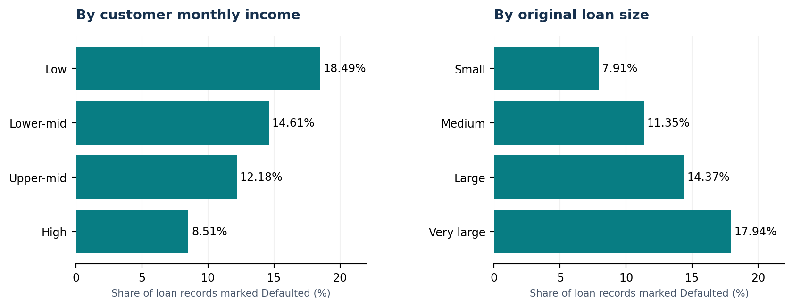

# Banking Loan Portfolio & Credit Risk Analysis (PostgreSQL)

**SQL portfolio project | Fictional Zambian commercial bank | Synthetic data**

This project investigates an illustrative banking loan portfolio using PostgreSQL. It demonstrates relational joins, Common Table Expressions (CTEs), customer and loan segmentation, conditional aggregation, financial KPIs, branch comparisons, and data-quality validation.

> **Important:** The bank and its customers are fictional. The figures do not describe an actual Zambian bank, and the analysis is not a forecast or formal regulatory credit-risk assessment.



## Business questions

- What is the size and composition of the bank's loan portfolio?
- How do observed default shares vary across income groups and original loan amounts?
- Which branches and loan types account for more defaults or defaulted original principal?
- Do loans with higher interest rates show different defaulted-record shares?
- How do loan-level default rates compare with the share of customers having at least one defaulted loan?
- Do the tables, relationships, counts, and financial aggregates pass quality checks?

## Tools and methods

- **Database:** PostgreSQL 14+; queries run through pgAdmin 4.
- **SQL methods:** `JOIN`, `LEFT JOIN`, `GROUP BY`, `CASE`, `SUM`, `COUNT`, `AVG`, `ROUND`, `NULLIF`, CTEs, validation queries.
- **Data:** 8 branches, 20,000 customers, 40,000 loan records, all generated synthetically.
- **Snapshot:** 25 October 2026 (fictional report reference date).

## Verified findings from the completed local analysis

| Measure | Result |
|---|---:|
| Customers / branches | 20,000 / 8 |
| Loan records | 40,000 |
| Recorded total original loan principal | **K5,672,889,156.80** |
| Defaulted loan records | **5,313 (13.28%)** |
| Original principal associated with defaulted loans | **K917,841,641.54 (16.18%)** |
| Average original loan amount | K141,822.23 |

**Key descriptive findings:**

1. **Customer income:** The lowest income group has an observed defaulted-record share of **18.49%**, versus **8.51%** in the highest group.
2. **Loan size:** Very large loans (K200,000+) show a **17.94%** defaulted-record share, versus **7.91%** for loans below K50,000. This group holds **K619.50 million** in recorded defaulted original principal.
3. **Interest rates:** Defaulted-record shares vary from **12.95% to 13.58%** across the four rate bands, without a monotonic pattern.
4. **Loan types:** Business loans have the highest observed defaulted-record share (**14.00%**), while personal loans have the largest absolute number of defaults (**1,685**).
5. **Branches:** Ndola has the largest number of defaults (**713; 14.17%**); Chingola has the highest recorded defaulted original principal (**K124.40 million**).
6. **Borrowing frequency:** Customers with 3+ loans hold **23,756** of the 40,000 loan records. Loan-level defaulted shares differ less by borrowing group (12.65%–13.44%) than customer-level prevalence of any default (12.65%–40.12%).

Full tables are in [`results/`](results/), and the [final management report](docs/Final_Banking_Capstone_Management_Report.docx) provides interpretation and recommendations.

## Repository structure

```text
.
├── README.md
├── sql/
│   ├── 00_setup_database.sql       # Generate a new synthetic database
│   ├── 01_verify_tables.sql        # Initial structure and integrity checks
│   ├── 02_portfolio_summary.sql    # Portfolio KPIs
│   ├── 03_loan_status_analysis.sql
│   ├── 04_default_risk_indicators.sql
│   ├── 05_branch_risk_summary.sql
│   ├── 12A_... to 17_... .sql      # Advanced segmentation and final checks
│   └── ALL_TASKS_12_TO_17.sql      # One convenient combined SQL file
├── results/                       # Saved VERIFIED aggregate query outputs
├── assets/                        # Summary chart
└── docs/
    ├── Final_Banking_Capstone_Management_Report.docx
    ├── data_dictionary.md
    └── methodology.md
```

## How to run the project

1. Install PostgreSQL 14+ and pgAdmin. Create a practice database (for example `banking_practice`).
2. In pgAdmin Query Tool, **run** [`sql/00_setup_database.sql`](sql/00_setup_database.sql) **once** against that database. It creates the `banking_capstone` schema, three tables and 40,000 fictional loan records. It does not change existing tables in the `public` schema.
3. Run [`sql/01_verify_tables.sql`](sql/01_verify_tables.sql) to check the record counts and links.
4. Run the relevant analytical scripts in [`sql/`](sql/); each named file returns an inspectable result table. The scripts for Tasks 12–17 are read-only.
5. Run the Task 16 data-quality scripts to verify the **newly generated** database, then interpret the resulting metrics.

**Reproducibility warning:** the setup uses PostgreSQL's `RANDOM()` without a fixed raw snapshot. A newly generated dataset will have the same intended structure and row counts but **different loan values, default counts, and aggregate results**. The specific figures presented above were verified from the author's original local PostgreSQL run and preserved as aggregate CSVs in `results/`; those files are **not** a full row-level data export. The fixed-value assertions in `16E_full_quality_assertions.sql` are specific to the original recorded snapshot and may fail for an independently regenerated dataset even when its data are otherwise valid.

## Important limitations

- Loan amount represents **original principal**, **not outstanding balance**, expected loss, recovered amount, or regulatory non-performing-loan exposure.
- `Defaulted` is a synthetic status. Default percentages are **shares of records at a snapshot**, not forward-looking default probabilities or causal effects.
- The data generator intentionally raises default propensity when original principal is large relative to monthly income. Observed patterns reflect this design; they are **not evidence about real Zambian borrowers**.
- There is no repayment cash flow, collateral, arrears duration, credit score, or actual loss data.
- Sample financial categories are illustrative and are not official regulatory or socioeconomic classifications.

## Validation

On the original local dataset, Tasks 16A–16E were executed and reported: no duplicate loan IDs, no unmatched loan-customer references, zero flagged missing/invalid fields, matching overall/subtotal amounts, and **7/7 PASS** final assertions. Results are recorded in [`results/validation_results.csv`](results/validation_results.csv).

## Suggested next extension

Export a **fixed, fully synthetic raw-data snapshot** (branches, customers and loans) to CSV to reproduce the exact aggregate figures on another computer, and build a Power BI dashboard using these SQL outputs. Do not upload any real banking customer information or personal identifiers.
